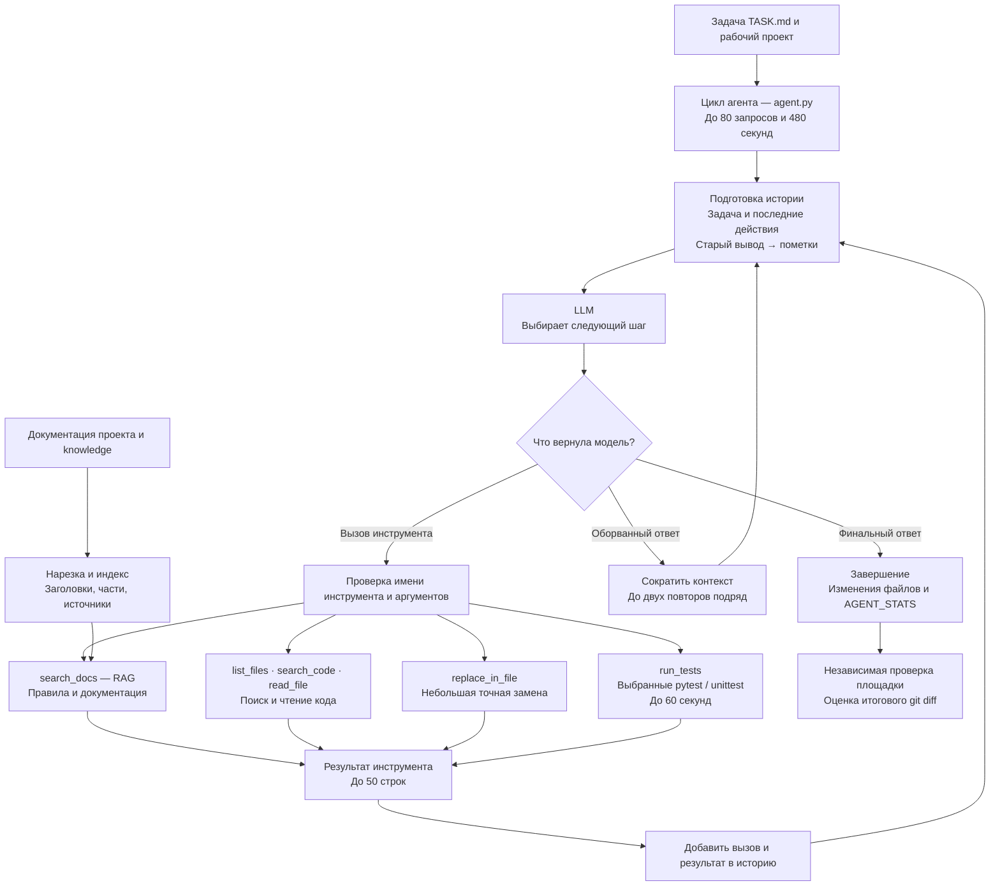
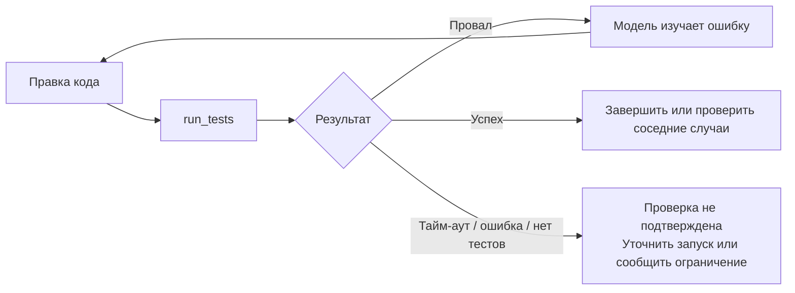

# Домашнее задание 3. Ограничение вывода и очистка истории

Агент продолжает проект второго задания. Основа обновления — README и шаблон
`homework_02_agent` второго занятия. Исходные комментарии TODO в `agent.py`
сохранены. Реализованы лимит вывода, очистка истории, поиск документации
и запуск выбранных тестов внутри цикла агента.

## Архитектура агента

Модель выбирает следующий шаг. Код агента выполняет инструменты, ограничивает
вывод и готовит историю для следующего запроса. Основной цикл:
**найти сведения → прочитать код → внести правку → проверить тестами → уточнить исправление**.



| Блок | Реализация | Роль |
|---|---|---|
| Цикл и инструменты | `agent.py` | Запросы к модели, проверка вызовов, работа с кодом и ограничения |
| История | `make_history`, `compact_turns` в `agent.py` | Замена старых результатов пометками и сокращение входа |
| Подготовка документов | `context_support.py` | Чтение, нарезка, метаданные и упаковка найденных фрагментов |
| Поиск | `search_support.py` | BM25, эмбеддинги и гибрид RRF |
| Исполнение тестов | `test_runner.py` | Запуск выбранных тестов, тайм-аут, статус и ограниченный журнал |
| Локальная оценка поиска | `search_docs.py` | Сравнение поиска отдельно от цикла кодера |

На площадке используется **BM25**. Эмбеддинги и гибрид доступны для локальных
экспериментов с явно настроенным сервером. Модель сама вызывает `search_docs`;
поиск документации не выполняется автоматически перед каждым ответом.

## Сравнение с уже проверенным ДЗ 2

ДЗ 2 остаётся в прежнем Git-коммите и в результатах платформы. В этой версии
нет переключателя hw2/hw3: отправляется только новый SHA ДЗ 3.
`agent.json` уже настроен на `--context-mode rag --search-mode bm25`.
Сравнивайте решённые задачи, шаги и токены со старым запуском при той же
модели и сопоставимом наборе задач. Если набор изменился, прямое сравнение
баллов некорректно. При недоступности старых счётчиков запросите их у организатора.
Поскольку одновременно добавлен поиск, сравнение показывает суммарный эффект
изменений, а не отдельный вклад очистки истории или RAG.

Каждый запрос к модели, включая повтор, считается шагом. В stderr печатается
JSON-строка `AGENT_STATS`: шаги, инструменты, ошибки, обрывы, очищенные результаты,
время, поисковые вызовы, размер индекса и токены из response.usage.
Выходные токены включают рассуждения, оборванные ответы тоже учитываются.
Если usage отсутствует хотя бы у одного запроса, общий итог токенов — null,
а reported_* содержит только известную часть. Статистика выводится и при ошибке.
`status=completed` означает завершение цикла, а не успешное решение.
Токены эмбеддингов локального эксперимента считаются отдельно в embedding_*.

## Порядок работы

1. **Получить задачу.** Прочитать `TASK.md`, определить рабочую папку и начать
   отсчёт времени. Содержимое всего репозитория заранее в модель не отправляется.
2. **Выбрать действие.** Модель получает инструкции, задачу и подготовленную
   историю, затем выбирает инструмент или завершает работу.
3. **При необходимости найти документацию.** `search_docs` ищет по документам
   текущего проекта и `knowledge`. Индекс строится при первом обращении.
   Разделы делятся на фрагменты до 2000 символов и 40 строк; сохраняются
   заголовки, источники, позиции и метаданные. Во вход попадает до трёх
   фрагментов. Запрос можно уточнять после изучения кода.
4. **Найти и прочитать код.** Использовать `list_files`, `search_code` и
   `read_file`; обычно читать по 30–40 строк.
5. **Внести небольшую правку.** `replace_in_file` применяет замену только при
   единственном точном совпадении исходного фрагмента. Ошибка возвращается
   модели для уточнения вызова.
6. **Проверить результат.** Перечитать изменённый код и вызвать `run_tests`
   для выбранного файла, папки или pytest node id. При провале тестов модель
   может исправить код и повторить проверку. Тайм-аут, отсутствие тестов и
   ошибка окружения не считаются успехом. После новой правки прежняя проверка
   помечается как устаревшая.
7. **Ограничить вывод и очистить историю.** Результат любого инструмента
   передаётся с исходным `call_id`, максимум 50 строк. Перед следующим запросом
   результаты старше двух последних шагов с инструментами заменяются пометками.
   Если история всё ещё превышает бюджет, сохраняются последние помещающиеся
   целые шаги и краткое состояние. Нужные сведения можно прочитать повторно.
8. **Восстановиться после обрыва.** Ответ со статусом `incomplete` не исполняется.
   Агент сокращает контекст, включает короткие инструкции и повторяет следующий
   шаг, не более двух повторов подряд. HTTP 413 обрабатывается аналогично.
9. **Завершить и записать статистику.** Ответ без вызовов завершает цикл.
   `AGENT_STATS` содержит шаги, токены, время, ошибки, поиск и результаты тестов.
   Достижение лимита также останавливает цикл. Итог для площадки — изменения
   файлов; число решённых задач определяет независимый оценщик.

### Обратная связь от тестов



Успех выбранных тестов даёт агенту обратную связь, но не гарантирует прохождения
полного бенчмарка. Повторные действия возможны только в пределах общего бюджета.

Программа проверяет JSON и типы аргументов, пути и однозначность замены.
Ошибки инструментов возвращаются модели, чтобы она могла уточнить вызов.
Проверки путей и однозначности замены взяты из шаблона второго занятия.
Запись ограничена рабочим репозиторием и запрещена в `.git`.
Запрет изменения тестов и служебных файлов остаётся инструкцией модели,
а не полноценным программным контролем доступа.

## Контроль прогресса после прогона default_03

По полученному отчёту default_03 решил 14/30 задач. Все 16 остальных запусков
достигли MAX_STEPS=30, а в 15 агент не дошёл до правок; search_docs в этих
задачах не вызывался. Это исходный результат, не оценка обновлённой версии.

Лимит увеличен до 80 запросов, общий бюджет остался 480 секунд.
После 6 поисков/чтений без успешной правки в историю добавляется краткая
подсказка: сформулировать гипотезу и перейти к минимальному патчу с тестом,
либо проверить один конкретный недостающий факт. После 12 таких действий
или при остатке не более 120 секунд приоритет правки и проверки подчёркивается.
Подсказка пересчитывается, а не накапливается отдельными сообщениями.

Повторные чтения распознаются по реально показанным строкам: совпадение
не менее 80% строк считается повтором, включая пересекающиеся диапазоны.
Повторный поиск определяется по инструменту, аргументам и результату.
Перечитывание не блокируется: оно нужно после очистки истории или изменения
кода. После успешной правки счётчики текущей серии и память повторов сбрасываются;
ошибка замены или замена текста на самого себя прогрессом не считаются.
Контроль не делает правки автоматически и не принуждает выдумывать исправление.

В AGENT_STATS добавлены first_edit_step, first_edit_seconds, successful_edits,
exploration_calls, max_exploration_streak, repeated_reads, repeated_searches
и progress_prompts. Отсутствие первой правки обозначается null.
Повторная доставка того же call_id не считается новым исполнением инструмента.
Эффект изменений необходимо измерить следующим прогоном на площадке.

## Ограничения и восстановление

- До 80 модельных запросов и 480 секунд на весь цикл; отдельный запрос до
  120 секунд, но не больше оставшегося времени. Повторы SDK отключены.
- До 4096 выходных токенов на запрос, включая рассуждения. Увеличивать этот
  параметр для обхода шлюза нельзя.
- История хранится локально, до 18 000 символов сериализованного JSON;
  это ограничение символов, не токенов. Описания инструментов и инструкции
  передаются отдельно. Слишком длинная сама задача вызывает явную остановку.
- Модели рекомендуется читать по 30–40 строк; любой результат инструмента
  перед отправкой ограничивается 50 строками (включая заголовок и пометку)
  и 4000 символами. Результаты старше двух последних шагов с инструментами
  заменяются пометками; вызовы и call_id сохраняются.
  Части `old_text`/`new_text` ограничены 2000 символами каждая.
- При `incomplete` или HTTP 413 оборванный ответ не исполняется и не попадает
  в историю. Агент сокращает бюджет истории и вывода инструментов, использует
  короткие инструкции и повторяет только следующий шаг. До двух повторов подряд.
- При сокращении истории сохраняются задача, список изменённых файлов, короткий
  журнал последних действий и столько последних целых шагов, сколько помещается.
  Вызов и его результат не разделяются; устаревший код можно перечитать.
- Повторный `call_id` с теми же аргументами возвращает сохранённый результат,
  не исполняя действие снова. Выполненные изменения остаются на диске даже
  при последующей ошибке или исчерпании лимита; итоговый diff оценивает платформа.
- Статус ответа, отказы и пустые ответы проверяются до исполнения инструментов.
  Ошибки API, кроме HTTP 413, завершают запуск. Шаги и ошибки печатаются в stderr.

## Проверка тестов внутри цикла

`run_tests(runner, target, timeout_seconds)` запускает существующие выбранные
тесты, без произвольной shell-команды. runner: pytest или unittest; target:
относительный путь .py-файла или папки. Для pytest доступны node id, например
`tests/test_stats.py::test_mean`. Для unittest используется discover по папке
или имени файла. Специальные раннеры проектов (например Django runtests.py)
пока не поддерживаются; их нельзя считать проверенными этим инструментом.

На вызов от 1 до 60 секунд; доступное время дополнительно ограничено остатком
общего бюджета агента за вычетом 10 секунд. При тайм-ауте останавливается
процесс (на Linux — его группа, на Windows — дерево через taskkill).
Вывод stdout/stderr читается одновременно с исполнением: в памяти остаётся
последние 64 КиБ. Модель получает статус, код завершения и конец журнала,
не больше 50 строк и текущего лимита символов (изначально 4000).
При большом выводе начало отбрасывается: его детали могут отсутствовать.

Статусы: PASSED, FAILED, ERROR, TIMEOUT, NO_TESTS. Отсутствие pytest,
ошибка окружения и отсутствие собранных тестов не являются успешной проверкой.
Установка зависимостей инструментом не выполняется. На Linux при наличии
conda используется `conda run --no-capture-output -n testbed python` согласно
инструкции стенда. Иначе — текущий Python. Для локальной проверки можно явно
задать путь к нужному Python через `AGENT_TEST_PYTHON`; отсутствие окружения
не приводит к скрытому повтору в другом интерпретаторе.

В AGENT_STATS добавлены test_runs и last_test. После новой правки last_test
помечается outdated=true до следующего запуска. Успех выбранных тестов
не доказывает прохождение полного бенчмарка: итоговую оценку выставляет стенд.


## Локальный журнал SQLite

Журнал включается только явным `--log-db`. Без этого параметра агент не
открывает SQLite и не создаёт файл базы. В agent.json параметра нет:
на площадке запуск остаётся без базы. Новые пакеты не требуются.

Пример локальной проверки (нужны ключ и модель, как для обычного запуска):

```powershell
python local_check/run_check.py --log-db "C:\Users\demch\agent_logs\runs.sqlite3"
```

При прямом запуске добавьте тот же параметр к agent.py:

```powershell
python agent.py --task-file "C:\tasks\TASK.md" --workspace "C:\projects\sample" --log-db "C:\Users\demch\agent_logs\runs.sqlite3"
```

Путь должен быть вне исправляемого workspace и каталога агента. Повторные
запуски дописываются в ту же базу, каждый получает UUID. Время записано в UTC.

| Таблица | Данные |
|---|---|
| runs | Начало/конец, статус, модель и режимы, workspace, хеш задачи и первые 2000 символов, SHA агента, хеш исходников, итог AGENT_STATS в summary_json |
| steps | Запросы модели (kind=model) и вызовы инструментов (kind=tool), номер модельного шага, статус, время, токены, размер истории; для инструментов — call_id, аргументы и ограниченный вывод |
| test_runs | Фактические запуски тестов, связь со steps, runner/target, статус, код выхода, время и вывод; outdated=1 после последующей успешной правки |

В steps один запрос с несколькими инструментами занимает несколько строк;
число запросов считайте только по kind=model. Доставка прежнего call_id
отмечается reused=1 и не создаёт ещё одну запись test_runs.
Неизвестные токены записываются как NULL. HTTP-ошибки и incomplete сохраняются.
Полные промпты, рассуждения, переменные окружения и ключи намеренно не записываются;
база содержит текст задачи и фрагменты рабочего кода из результатов инструментов.
Аргументы и вывод ограничены 4000 символами, это журнал для анализа, не полная трасса.

Каждая запись сразу фиксируется. При жёстком завершении процесса запуск может
остаться running без finished_at — это незавершённая попытка. Ошибка открытия
или записи базы выводит SQLITE_LOG_DISABLED и отключает дальнейшую запись,
не прерывая решение. Статус completed означает завершение цикла, а не решённую
задачу; независимые тесты local_check и оценка платформы в базу не импортируются.
Хеш исходников помогает различать незакоммиченные версии с одинаковым SHA;
содержимое knowledge в этот хеш не входит.

Примеры запросов в любом SQLite-клиенте:

```sql
SELECT id, started_at, status, agent_commit,
       json_extract(summary_json, '$.steps') AS model_steps,
       json_extract(summary_json, '$.first_edit_step') AS first_edit,
       json_extract(summary_json, '$.total_tokens') AS tokens
FROM runs ORDER BY started_at DESC;

SELECT model_step, kind, tool, status, seconds, output
FROM steps WHERE run_id = 'UUID_ЗАПУСКА' ORDER BY id;

SELECT runner, target, status, exit_code, outdated
FROM test_runs WHERE run_id = 'UUID_ЗАПУСКА' ORDER BY id;
```

Агент не читает прошлые попытки для решения следующих задач. Это локальный
журнал для сравнения версий и поиска причин ошибок, без автоматической памяти.

## Установка и локальная проверка

Python 3.11, `openai==2.26.0`; зависимости зафиксированы в `uv.lock`.

```powershell
uv sync --locked
Copy-Item .env.example .env
# Укажите свой ключ и модель в .env, только если они у вас есть.
uv run python local_check/run_check.py
```

Без `uv` можно использовать существующее виртуальное окружение с зависимостями
из `pyproject.toml` и выполнить `python local_check/run_check.py`.
Скрипт читает `.env`, создаёт копию учебного проекта, запускает агента, показывает
`git diff` и выполняет проверочные тесты. Локальный запуск с настоящей моделью
требует собственного API-ключа. Имитация ответов проверяет только механику агента.

## Проверка и сдача на Planerverse

Личный API-ключ для демо на сайте не нужен: временный ключ выдаёт стенд.
В корне публичного репозитория должны находиться `agent.json`, `agent.py`,
`README.md`, `pyproject.toml` и `uv.lock`. Не публикуйте `.env` и ключи.

1. Сделайте коммит и push обновлённых файлов.
2. Получите полный SHA: `git rev-parse HEAD`.
3. На [planerverse.ru](https://planerverse.ru/) укажите репозиторий и этот SHA.
4. Пройдите обе проверки демо: маленькую задачу и задачу с большим числом файлов
   и искусственным первым `incomplete`. Это критерий второй домашки.
5. Отправьте заявку. После новых правок нужен новый коммит и SHA.

По README курса дедлайн — **29 октября 2026, 23:59 МСК**.

## Контракт платформы

Запуск: `python /agent/agent.py --task-file /task/TASK.md --workspace /testbed`.
Код агента в `/agent` доступен только для чтения; изменяется `/testbed`.
Модель, адрес и ключ поступают через `OPENAI_MODEL`, `OPENAI_BASE_URL`,
`OPENAI_API_KEY`.
На платформе используется `deepseek-v4.1-flash`, thinking high.
Нет серверной истории, `previous_response_id`, внешних сервисов или hosted tools.
`strict` не включён без проверки поддержки шлюзом.

Актуальные ограничения определяет [техническая инструкция платформы](https://planerverse.ru/participant-agents.md).


## Поиск по практике занятия 1.3

Из `practice/helpers/search.py` взяты алгоритмы BM25 (k1=1.5, b=0.75),
косинусное сходство эмбеддингов и RRF: сумма 1/(60 + место) из top-20
двух поисков. Из мини-кодера перенесена схема инструмента `search_docs`:
модель сама решает, когда искать документацию, и может уточнять запрос.
Это адаптация практики к произвольному репозиторию, а не копия магазина «Север».
Учебные правила магазина и скрытые проверки в библиотеку агента не включены.

- `context_support.py`: чтение документов, разделы, метаданные и ленивый индекс.
- `search_support.py`: BM25, поиск по эмбеддингам и гибрид RRF.
- `search_docs.py`: локальная проверка поиска и recall@5 по вопросам.
- `knowledge/`: собственные документы UTF-8 (.md, .rst, .txt).

Первый источник — Git-документы исправляемого проекта: README, CONTRIBUTING,
AGENTS, md/rst из docs/doc. Второй — knowledge рядом с агентом.
Индекс строится при первом поиске и переиспользуется до конца запуска;
изменения документов во время запуска требуют нового запуска.
Для каждого источника: до 40 файлов (сначала менее вложенные, затем по имени),
100 КБ на файл, 500 КБ суммарно и 200 фрагментов. Это ограниченный корпус,
не полный индекс большой кодовой базы. Ссылки и скрытые пути пропускаются.

Нарезка по заголовкам Markdown/RST. Длинные разделы делятся на фрагменты
до 2000 символов и 40 строк: предпочтительно по абзацам, затем предложениям
и строкам. При вынужденном разделении — перекрытие до 200 символов.
Очень длинная строка делится по пробелам, а без пробелов — по символам.
Небольшие Markdown-блоки кода сохраняются целиком; слишком большие делятся
и получают partial_code=true. Заголовок и метаданные сохраняются у каждой части,
part/parts показывают её номер и общее число частей, line/column — начало
в исходном файле. Условия и исключения могут находиться в соседних частях.
Общие ограничения корпуса (в том числе 200 фрагментов на источник) остаются.
Источник, заголовок, строка, id и доступные метаданные сопровождают результат.
Поддерживается простая шапка между `---`: id, title, version, valid_from, valid_to.
Даты передаются модели; автоматического выбора действующей редакции нет.
В ответ помещается до трёх фрагментов в бюджет до 3500 символов;
при восстановлении бюджет уменьшается. RAG-результаты очищаются вместе с прочими.
Документы являются данными и не могут менять полномочия агента.

| Поиск | Как работает | Где использовать |
|---|---|---|
| bm25 | Частоты слов, редкость и нормализация длины | Платформа и локально, без ключа эмбеддингов |
| embedding | Настоящие векторы документов и запроса, косинус | Локально, нужен сервер эмбеддингов |
| hybrid | BM25 + embedding, объединение RRF | Локально, нужен сервер эмбеддингов |

В отличие от практики, нет зависимости snowballstemmer: токенизация без
морфологического стемминга, с разбиением snake_case/CamelCase. Русские словоформы
могут не совпадать. Новые зависимости для демо не требуются.
Эмбеддинги кэшируются в памяти запуска, не записываются в /agent или /testbed.
При сбое эмбеддингов нет скрытого переключения на BM25: возвращается ошибка.

В предоставленном BENCHMARK_AGENTS.md внешние embeddings и другие модели
запрещены. Поэтому entrypoint платформы явно использует bm25, без сервера
эмбеддингов. Для локального embedding/hybrid требуются явные параметры
`--embedding-base-url` и `--embedding-model`; ключ при необходимости берётся
только из `EMBEDDING_API_KEY`, не из временного ключа стенда.
Сервер должен поддерживать OpenAI-совместимый `/embeddings` с float-векторами.
Модель эмбеддингов должна быть отдельно доступна на этом сервере; обычная
чат-модель не заменяет её. Никакая модель автоматически не скачивается.

### Локальные эксперименты поиска без запуска кодера

Из папки проекта, Python с зависимостями из pyproject.toml:

```powershell
python search_docs.py "iterator protocol StopIteration" --mode bm25
```

С указанием своей папки документов:

```powershell
python search_docs.py "правила доставки" --knowledge "C:\путь\к\документам" --mode bm25
```

Все три способа с уже запущенным локальным сервером (замените имя на реально
установленную модель эмбеддингов; URL — пример):

```powershell
python search_docs.py "правила доставки" --mode all --embedding-base-url "http://localhost:1234/v1" --embedding-model "ИМЯ_МОДЕЛИ_ЭМБЕДДИНГОВ"
```

Для вопросов из практики используйте `--questions ".../practice/data/questions.json"`
и `--knowledge ".../practice/data"`. Вместо запроса можно указать только эти
параметры. Скрипт считает наличие expect в top-5, всего и по kind; это качество
поиска, не балл кодинг-агента. Для сравнения всех трёх добавьте `--mode all`
и параметры сервера. Реальное качество эмбеддингов без сервера не проверяется.

### Включение поиска в кодере

По умолчанию: rag + bm25. Для локального эксперимента к обычной команде
agent.py с --task-file и --workspace добавьте:

```text
--search-mode hybrid --embedding-base-url http://localhost:1234/v1 --embedding-model ИМЯ_МОДЕЛИ_ЭМБЕДДИНГОВ
```

`--context-mode baseline` отключает RAG и дополнительные правила,
`rules` оставляет только правила, `rag` открывает search_docs (по умолчанию).
Модель, исправляющая код, по-прежнему требует OPENAI_API_KEY, OPENAI_BASE_URL
и OPENAI_MODEL. Поиск BM25 отдельно через search_docs.py этих переменных не требует.
Внутри цикла используется адаптированный run_tests из test_runner.py,
поддерживающий выбранные pytest/unittest с лимитами; итоговая проверка
local_check и стенда остаётся независимой.

Для отправки нового ДЗ 3 включите agent.py, agent.json, context_support.py,
search_support.py, search_docs.py, test_runner.py, run_store.py, README.md и knowledge в коммит и push.
Укажите новый SHA в заявке; сохранённое ДЗ 2 повторно отправлять не нужно.
